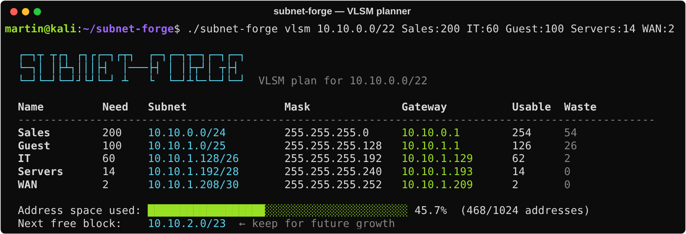
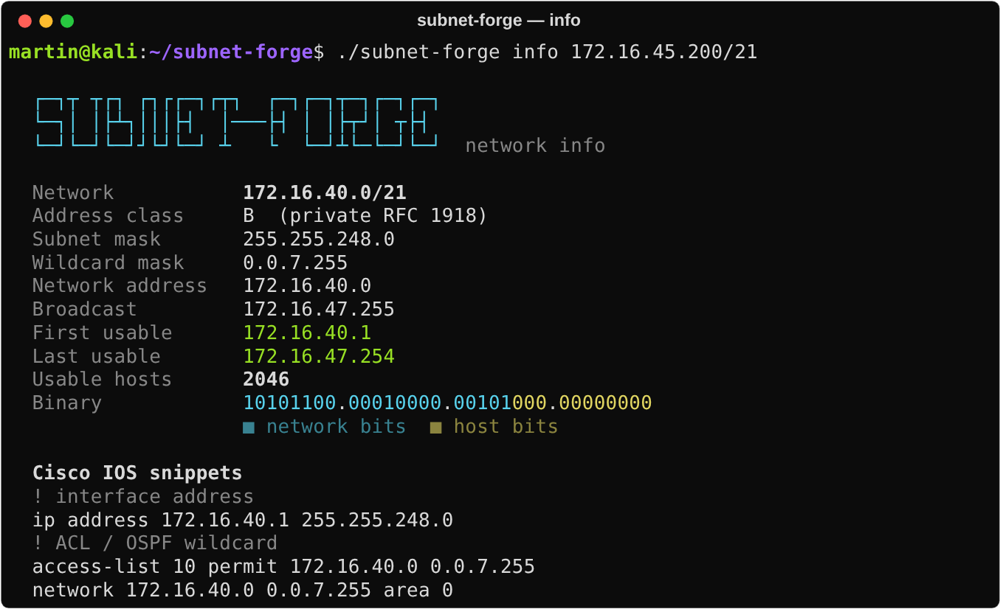
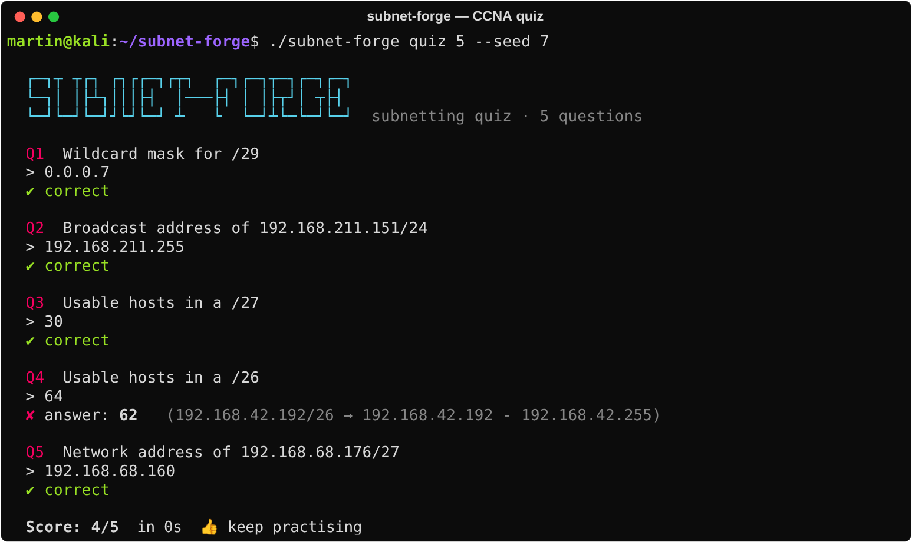
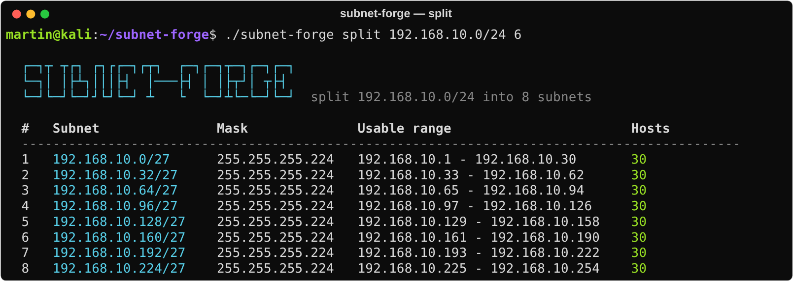
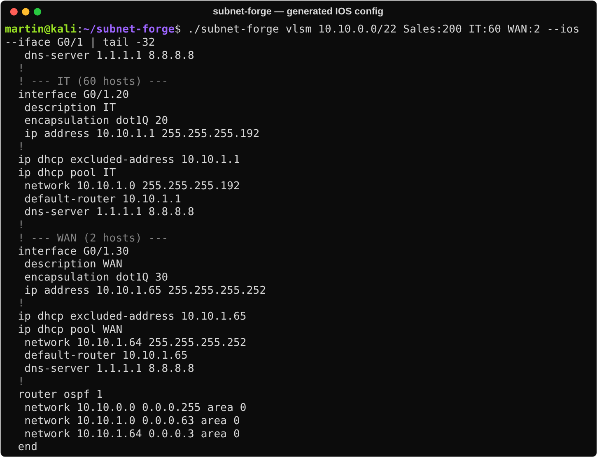

<div align="center">

# 🧮 subnet-forge

**A CCNA subnetting toolkit in modern C++: calculate, plan VLSM, and generate ready-to-paste Cisco IOS config.**




</div>
> 🎥 **[Watch the demo video →](docs/demo.mp4)** (download to play)


---

## 📖 About

While studying for the **CCNA**, I kept doing the same three things by hand: subnetting, VLSM planning
and typing the matching router config. **subnet-forge** does all three in one command, and it includes a
**quiz mode** to practise exam-style subnetting questions.

It's built from scratch in C++17 with a small header-only IPv4 library (`src/ipv4.hpp`). It uses no
external libraries and only bit operations on `uint32_t`, the same way a router works.

## ✨ Features

| Command | What it does |
|---|---|
| `info`  | Network/broadcast/host range, mask, **wildcard**, class, RFC 1918 check, **colour-coded binary**, IOS snippets |
| `split` | Divide a network into N equal subnets |
| `vlsm`  | Plan VLSM from `NAME:HOSTS` requirements (largest first, aligned, no overlaps), show wasted addresses and the **next free block** |
| `vlsm --ios` | Generate a **router-on-a-stick + DHCP pools + OSPF** config for the plan |
| `quiz`  | Timed CCNA-style questions (network, broadcast, hosts, wildcard) with explanations |

## 📸 Screenshots

<table>
<tr><td width="50%"><b>info</b>: binary view and IOS snippets<br></td>
<td width="50%"><b>quiz</b>: practise for the exam<br></td></tr>
<tr><td><b>split</b><br></td>
<td><b>vlsm --ios</b>: generated config<br></td></tr>
</table>

---

## 🚀 Tutorial

### 1. Build

**Linux / macOS / WSL**

```bash
git clone https://github.com/Martun1/subnet-forge.git
cd subnet-forge
cmake -S . -B build -DCMAKE_BUILD_TYPE=Release
cmake --build build
./build/subnet-forge --help
```

**Windows (Visual Studio 2019+, or CLion)**

```powershell
cmake -S . -B build
cmake --build build --config Release
.\build\Release\subnet-forge.exe --help
```

> CLion users: just open the folder. CLion detects `CMakeLists.txt` automatically.

Run the unit tests with `ctest --test-dir build`.

### 2. Analyse a network

```bash
./build/subnet-forge info 172.16.45.200/21
./build/subnet-forge info 192.168.1.77 255.255.255.224   # dotted mask works too
```

In the binary row, **cyan bits are the network part** and **yellow bits are the host part**. This is
the fastest way to *see* why `172.16.45.200/21` belongs to `172.16.40.0`.

### 3. Split a network

```bash
./build/subnet-forge split 192.168.10.0/24 6     # rounded up to 8 × /27
```

### 4. Plan a real office with VLSM

Scenario: you get `10.10.0.0/22` for an office with Sales (200 PCs), Guest Wi-Fi (100), IT (60),
Servers (14) and a WAN point-to-point link.

```bash
./build/subnet-forge vlsm 10.10.0.0/22 Sales:200 Guest:100 IT:60 Servers:14 WAN:2
```

The planner always places **the largest subnet first** so every block lands on a valid boundary.
It also tells you how much space is left (`10.10.2.0/23`) for future growth.

### 5. Generate the router config

```bash
./build/subnet-forge vlsm 10.10.0.0/22 Sales:200 Guest:100 IT:60 --ios --iface GigabitEthernet0/1 -o office.cfg
```

For every subnet you get a dot1Q sub-interface (VLAN 10, 20, 30...), an excluded gateway address, a
DHCP pool, and OSPF `network` statements with the correct wildcard masks. Paste it into **Packet
Tracer**, connect a switch with matching VLANs on a trunk, and the PCs get addresses over DHCP.

> ⚠️ Generated configs are a starting point for labs. Review VLAN IDs, DNS servers and OSPF areas before
> you use them in production.

### 6. Practise for the CCNA

```bash
./build/subnet-forge quiz 10
```

Type each answer and press Enter. Wrong answers show the full range, so you learn from every mistake.
Use `--seed 42` to get the same questions again (useful for study groups).

---

## 🧠 How it works

```cpp
uint32_t mask      = 0xFFFFFFFF << (32 - prefix);   // /21 → 255.255.248.0
uint32_t network   = ip & mask;                     // AND with the mask
uint32_t wildcard  = ~mask;                         // 0.0.7.255
uint32_t broadcast = network | wildcard;            // OR with the wildcard
```

**VLSM algorithm:** sort requirements by host count (descending). For each one, find the smallest
prefix with `2^(32-p) - 2 ≥ hosts`, round the cursor up to a multiple of the block size (alignment),
allocate it, and move on. The unit tests verify that no two subnets ever overlap.

## 🧱 Project structure

```
subnet-forge/
├── src/ipv4.hpp          # header-only IPv4 library (parse, mask math, split, VLSM)
├── src/main.cpp          # CLI: info / split / vlsm / quiz
├── tests/test_ipv4.cpp   # 30 unit checks (no framework needed)
├── CMakeLists.txt
└── .github/workflows/ci.yml   # builds and tests on Linux, Windows and macOS
```

## 🗺️ Roadmap

- [ ] IPv6 support (`/64` planning, EUI-64)
- [ ] Route summarisation (`summarize 10.1.0.0/24 10.1.1.0/24 ...`)
- [ ] Export the plan as CSV or Markdown for documentation

---

<div align="center">
Made by <a href="https://github.com/Martun1">Martin Ivanov</a> · CCNA · eJPT · Computer Science @ NBU
</div>
